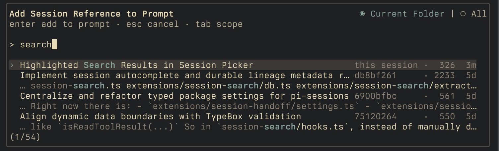
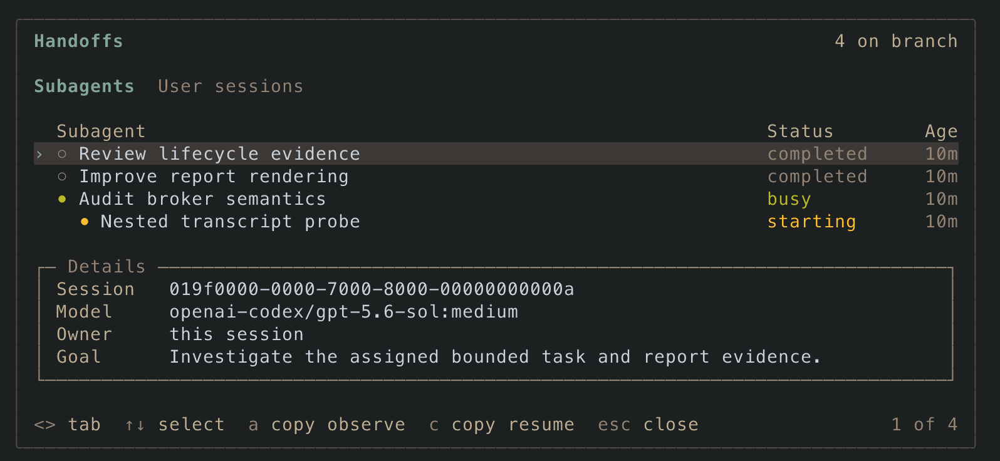
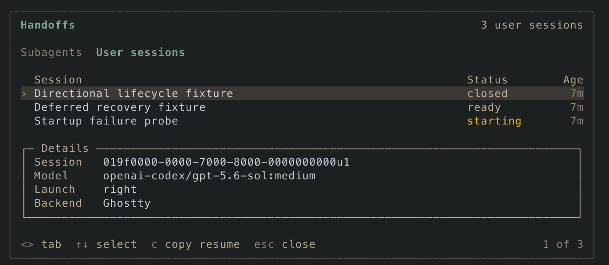
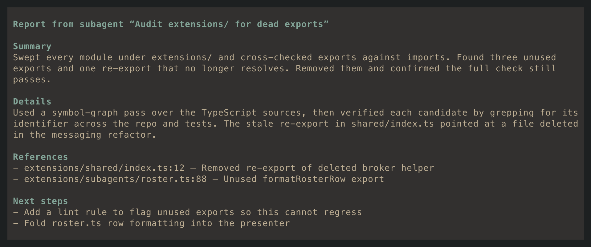
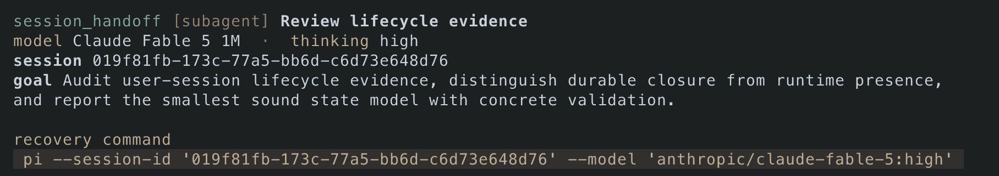
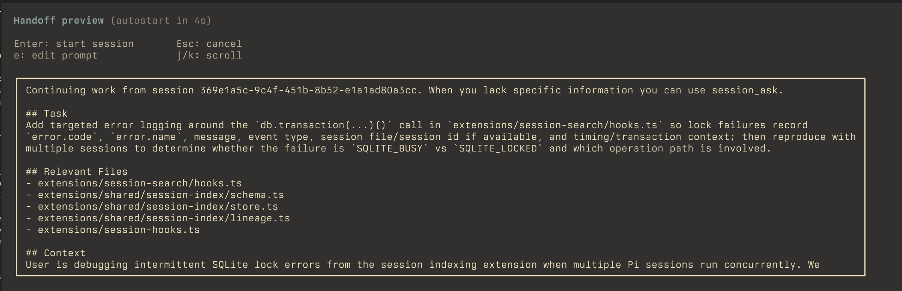
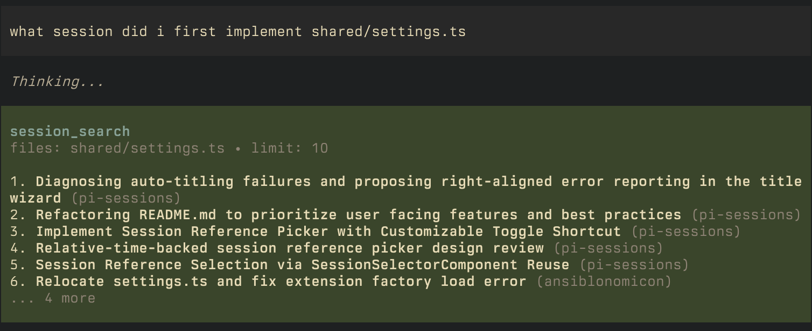
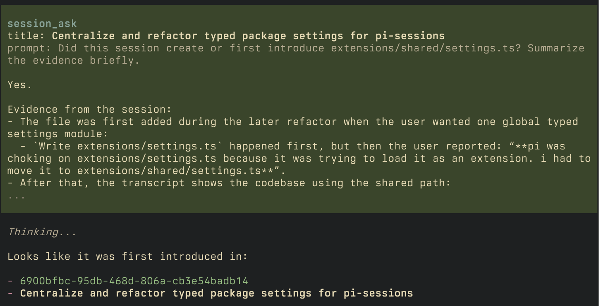
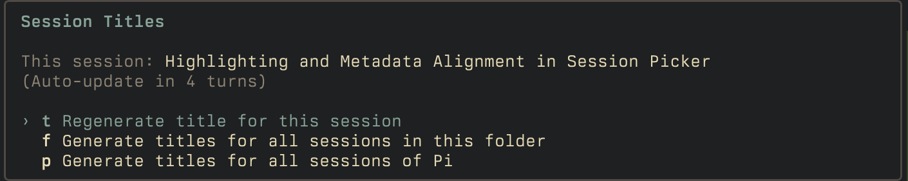

# pi-sessions

`pi-sessions` turns your old Pi sessions into something you can actually reuse. It gives you search, follow-up Q&A, deliberate handoffs into new child sessions, automatic session titles, and a local index that keeps future sessions searchable.

## Screenshots

### Session lookup



### Handoff board





### Subagent report



### Session handoff



### Handoff prompt review



### Ask about old sessions





## Install

Requires Pi `0.99.1` or newer and Node `>=24 <26`.

**From npm** (recommended):

```bash
pi install npm:pi-sessions
```

If you want to run directly from a local clone while developing:

```bash
pi -e /absolute/path/to/pi-sessions
```

## Quick start

1. Install the package.
2. Open Pi. Your prior sessions are indexed automatically in the background.
3. Try the main flows:

```text
What session did I implement the db layer?
```

```text
Open the frontend implementation task in a session to the right.
```

## Features

| Extension          | Surface                                                                | What it does                                            |
| ------------------ | ---------------------------------------------------------------------- | ------------------------------------------------------- |
| Session Search     | `session_search` pi tool                                               | Search through old sessions                             |
| Session Ask        | `session_ask` pi tool                                                  | Ask questions about old sessions                        |
| Session Handoff    | `session_handoff` pi tool, `/handoff` board                            | Start user-facing child sessions                        |
| Session Messaging  | `session_reachable`, `session_send_message`, `session_cancel` pi tools | Coordinate between live user-facing Pi sessions          |
| Subagents          | `subagent_list`, `subagent_send`, `subagent_cancel`, `subagent_launch`, `submit_task_report` | Delegate and manage background work |
| Session Picker     | `Alt+O`                                                                | Reference old sessions in your prompt                   |
| Session Index      | `/session-index` slash command                                         | Shows index status and rebuilds the local session index |
| Session Auto Title | in background, `/title` slash command                                  | Give sessions titles                                    |

Settings live under `sessions` in `~/.pi/agent/settings.json`. A project's `.pi/settings.json` overrides them the way pi merges its own settings: nested objects merge key by key, and the project wins.

Every feature is on by default. Turn one off with `enable: false` under its own settings namespace. Index recovery and startup/switch sync always run, including when search is disabled. `hooks.enable` controls turn, tree, and compaction sync, not startup recovery.

```json
{
  "sessions": {
    "messaging": { "enable": true },
    "subagents": { "enable": true },
    "handoff": { "enable": true },
    "search": { "enable": true },
    "ask": { "enable": true },
    "autoTitle": { "enable": true },
    "hooks": { "enable": true }
  }
}
```

## Session Search

`session_search` searches the local session index by text, repo, cwd, time range, and file evidence.

Queries support regular text for normal usage, quoted phrases, `AND` / `OR` / `NOT`, parentheses, and `-term` negation when matching needs to be stricter. Unquoted terms use prefix matching, quoted terms are exact. A search with no query returns matching sessions chronologically, newest first.

File filters distinguish read-or-write evidence from write-only evidence:

- `files.touched`: sessions that read or changed a path
- `files.changed`: sessions that changed a path

Use `kind: "user"` or `kind: "subagent"` to filter by session type across the whole index. Searching for sessions that can be addressed right now is a different question, answered by `session_reachable`.

## Session Handoff

The `session_handoff` tool creates a user-facing child session with a self-contained task. Ask for a direction when you want a visible split, or a deferred handoff when you only want the prepared session. Use `subagent_launch` to delegate suitable independent work to a background subagent.

Directional launches use Herdr when pi runs in a Herdr pane, then tmux when the current terminal is inside tmux, or Ghostty on macOS. Deferred launches create the child without starting it and copy its resume command to the clipboard. A background subagent runs in a detached tmux window, or in its own background tab in the parent's workspace when pi runs in a Herdr pane, and reports back when finished; note that subagents are started with `--approve`, meaning pi will always start in the directory as trusted.

When a host claims peers, pi-sessions leaves all user-facing coordination and launches to it. Subagent tools remain available; external-host launch targets are not part of pi-sessions.

Run `/handoff` to open the **Handoffs** board. The Subagents and User sessions tabs show status, age, launch details, and the actions currently available: stop, copy an observation command, or copy a resume command. With a peer-claiming host, only Subagents are shown.

Both launch tools take `goal`, `title` (at most 64 characters), and `requestResponse`, with optional `cwd`, `provider`, `model`, and `thinkingLevel` (`off`, `minimal`, `low`, `medium`, `high`, `xhigh`). `session_handoff` additionally requires `launch` (`left`, `right`, `up`, `down` when a split backend is available, or `deferred` when enabled). `subagent_launch` has no `launch` parameter, but takes an optional `agent` naming an [agent profile](#agent-profiles). Provider and model must be supplied together.

## Session Messaging

Standalone agents can coordinate with live user-facing Pi sessions:

- `session_reachable({})` lists live user sessions only; there is no scope parameter
- `session_send_message({ session, message, requestResponse })` sends a message to a live user session
- `session_cancel({ session })` aborts another live user session's current turn

Subagent coordination is a separate addressable directory:

- `subagent_list({ scope? })` lists the ledger/roster with `branch` (default) or `tree` scope
- `subagent_send({ session, message, requestResponse })` sends to a live subagent (including siblings) or a dormant owned worker, waking owned workers automatically
- `subagent_cancel({ session })` stops a subagent, recording owned cancellation intent before teardown
- `subagent_launch` creates a delegated background worker (parameters above)
- `submit_task_report({ status, summary, details?, references?, nextSteps? })` reports to the parent; available only in a subagent session

Pass bare session UUIDs, not `@session:` tokens. A subagent cannot message or cancel its parent; it reports through `submit_task_report`. Incoming messages start an idle recipient and steer a running one. Other dormant sessions cannot receive messages, but remain searchable with `session_search` and `session_ask`. Cancellation results describe delivery and, when available, the resulting worker state; they do not expose transport/managed subsystem tags.

## Host extension API

A host claims ownership of peer coordination, rather than supplying launch, listing, or wake callbacks. External extensions register over `pi.events`; neither extension imports the other.

Install a listener during extension initialization, **not** in your `session_start` handler:

```ts
pi.events.on("pi-sessions:hosts", (request) => {
  const { register } = request as HostRegistrationRequest;
  register({ name: "swb", peers: true });
});
```

The structural types below are the public contract; copy them into your extension or define compatible types locally:

```ts
interface HostRegistrationRequest {
  register(host: Host): void;
}

interface Host {
  name: string;
  peers: true;
}
```

- **Registration:** pi-sessions emits `pi-sessions:hosts` at every `session_start`, including reloads and switches. Register synchronously before returning or awaiting anything. Registration freezes when `emit` returns; late calls throw. Names must match `[a-z][a-z0-9-]*`, be unique, and cannot be `left`, `right`, `up`, `down`, `deferred`, `subagent`, `tmux`, `ghostty`, or `herdr`. TypeBox validates exactly `{ name, peers: true }`; additional properties are rejected.
- **Ownership:** any registered claim suppresses pi-sessions' `session_reachable`, `session_send_message`, `session_cancel`, and `session_handoff`. Peer tools are never registered at extension load, so a host may register its own tools at load without conflicts. Discovery runs before late registration. Pi currently has no tool-unregistration API: definitions retained from a prior standalone session are deactivated with `setActiveTools` and execution-guarded; reload rebuilds registrations. A new standalone session reactivates pi-sessions' tools.
- **Subagents:** `subagent_list`, `subagent_send`, `subagent_cancel`, `subagent_launch`, and `submit_task_report` remain pi-sessions-owned under a host. Availability still follows feature settings, a Herdr pane or tmux installation, delegation depth, and whether the caller is a subagent. The host supplies no waker; owned-worker recovery retains its two 30-second broker-registration waits.

## Durable lineage entry

Any extension may append this custom entry to a child session:

```ts
{
  type: "custom",
  customType: "pi-sessions.lineage",
  data: {
    parentSessionId: "parent-session-uuid",
    parentSessionFile: "/absolute/path/to/parent.jsonl", // optional
  },
}
```

Using Pi's extension API, call `pi.appendEntry("pi-sessions.lineage", { parentSessionId, parentSessionFile? })` in the child (Pi supplies the entry id, timestamp, and tree link). The index uses the first TypeBox-valid lineage entry only when the session header has no `parentSession`; the header takes precedence. The parent id works even without an accessible parent file. This durable relation survives leaving a host; the SQLite index is only its rebuildable cache.

## Session picker

Directly reference prior sessions by looking them up by contents.

- shortcut: `Alt+O`
- press `Tab` to switch between current folder and all sessions
- type to filter results
- press `Enter` to insert a session id into your prompt

### Handoff setting

If you want to override the shortcut, put this in your `~/.pi/agent/settings.json`:

```json
{
  "sessions": {
    "handoff": {
      "pickerShortcut": "alt+p",
      "model": "openai-codex/gpt-5.6-terra",
      "thinkingLevel": "low",
      "roster": ["anthropic/*", "openai-codex/gpt-5.6-terra:high"],
      "deferred": {
        "enable": true,
        "copyToClipboard": true
      }
    }
  }
}
```

`model` and `thinkingLevel` configure the agent that builds handoff prompts. They default to the new session's values when absent.

`roster` limits which models a handoff may launch a child session on. Defaults to pi's own `enabledModels` scoping, then to all configured models. May optionally include a thinking level; listing a model more than once adds to the levels it allows.

`deferred.enable` (default `true`) offers the `deferred` peer launch. Turn it off to leave only split launches. Hosts own their own launch policy.

`deferred.copyToClipboard` (default `true`) controls whether deferred handoffs copy the resume command to the clipboard. When off, the resume command is only shown in the tool call.

Subagents require the handoff and messaging features. Limit recursive delegation depth with `sessions.subagents.maxDepth` (default `2`), or cap the context a subagent runs in with `sessions.subagents.contextLimit`:

```json
{
  "sessions": {
    "subagents": {
      "maxDepth": 2,
      "contextLimit": 400000
    }
  }
}
```

`contextLimit` sets a max context limit before compaction is triggered. It works identically to setting a global value in pi itself, but only applies to subagents.

### Agent profiles

An agent profile lets `subagent_launch` start a subagent with extra instructions, a pinned model, and a thinking level, by name. Profiles are Markdown files in `~/.pi/agent/agents/`, in Claude Code's subagent format, so the same file works in both:

```markdown
---
name: oracle
description: Read-only second opinion on a plan, diff, or hard bug. Use for reviews and high-impact judgment calls.
model: anthropic/claude-fable-5-1:high
---

You are the Oracle: a read-only reviewer. Do not modify files. ...
```

- `name` must match the file name, and `description` tells the calling agent when to use the profile; both are required. The `subagent_launch` prompt guidelines list every valid profile with its description.
- `model` is a pi model pattern (`provider/id` or a bare id, optionally with `:<thinking>`), and `thinkingLevel` sets the level separately. Explicit `provider`/`model` and `thinkingLevel` on the launch win, and the resolved model must still be on the handoff roster.
- `tools` is a comma-separated allowlist passed to `--tools`; `submit_task_report` is always kept. Without it, the subagent has every tool.
- The body is added to the subagent's system prompt, in the subagent section after its standard instructions; `AGENTS.md`, extensions, and the report flow are unchanged. The instructions are stored in the child session when it launches, so later edits to the file don't change a running subagent.

Naming a missing or malformed profile fails the launch with the reason. Profiles apply only to subagents, not to `session_handoff`. Move the directory with `sessions.subagents.agentsDir` (an absolute path or one starting with `~/`).

## Session Index

The index is a shared cache of your transcripts, used by search, messaging, and the other session features. Pi checks transcripts at startup and syncs files that changed, including sessions run without pi-sessions loaded. Missing, older-schema, or unreadable indexes rebuild automatically in the background; unreadable databases are moved aside rather than overwritten. A malformed transcript is skipped and reported.

During recovery, a tool may say "Session indexing in progress; try again shortly." Only one process rebuilds at a time, and readers retain the old index until its replacement is ready. Failed attempts share a backoff of 1 minute, then 5 minutes, then 30 minutes. `/session-index` shows status; press `r` to rebuild now, ignoring the backoff.

If another Pi writes a newer index schema, the older process stops using the index and displays "pi-sessions was updated; /reload to use it". Reload instead of rebuilding: older code cannot replace a newer schema.

By default the index lives at:

```text
~/.pi/agent/pi-sessions/index.sqlite
```

but you can change the location in `~/.pi/agent/settings.json`:

```json
{
  "sessions": {
    "index": {
      "dir": "~/.pi/agent/pi-sessions"
    }
  }
}
```

## Session Auto Title

The auto-title extension keeps your session list readable by:

- Setting a title based on initial prompt
- Reevaluating the title every 4 turns to see if it should be updated

To manage existing titles, run `/title`, where you can:

- Regenerate a title for the current session
- Generate titles for all sessions in the folder
- Generate titles for all sessions across pi



Note that generating titles for all sessions can take some time, and will hit your configured model with the full contents of all sessions.

- automatic retitles run every few turns
- if you manually rename a session with `/name`, automatic retitling pauses for that session
- Regenerate the title for the current session to resume automatic retitling
- if unconfigured, it will attempt to use these models in order, first one that is available:
  - `openai-codex/gpt-5.6-luna`
  - `openai/gpt-5.6-luna`
  - `anthropic/claude-haiku-4-5`
  - `google/gemini-flash-lite-latest`
  - your currently configured model

To change auto-titling settings, edit `~/.pi/agent/settings.json`:

```json
{
  "sessions": {
    "autoTitle": {
      "refreshTurns": 4,
      "timeoutSecs": 15,
      "tokenBudget": 512,
      "model": "anthropic/claude-haiku-4-5",
      "thinkingLevel": "off",
      "prompt": "Custom prompt that overrides the default.",
      "persistRuns": false
    }
  }
}
```

`persistRuns` records each title request as its own session file under `~/.pi/agent/pi-sessions/session-auto-title/`, holding the exact prompt and response. Open one with `pi --session <file>` to see what the titling model was sent.

## Development

```bash
mise trust && mise bootstrap
mise run check
mise run test
```

For an end-to-end manual flow, see [SMOKE.md](./SMOKE.md).
